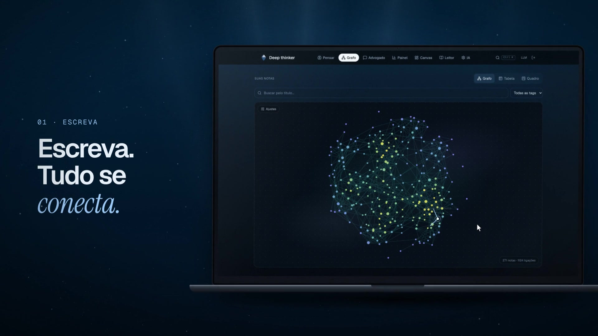
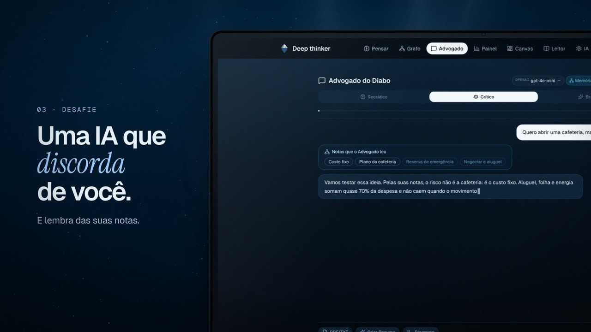
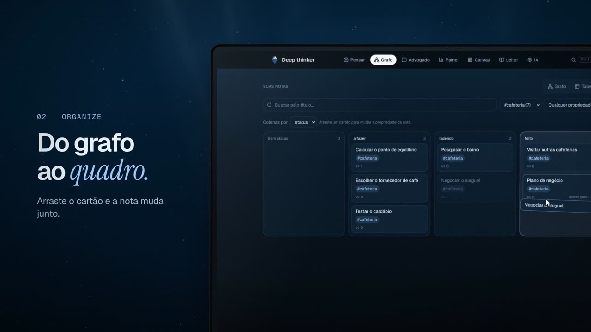
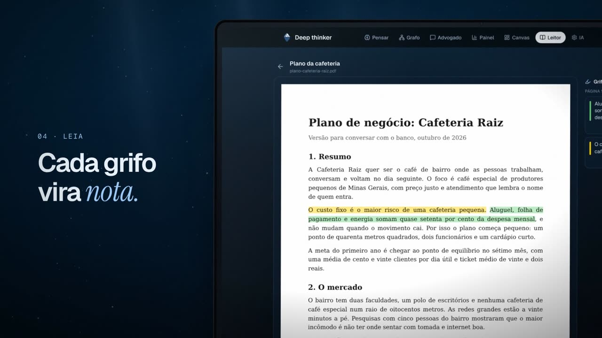
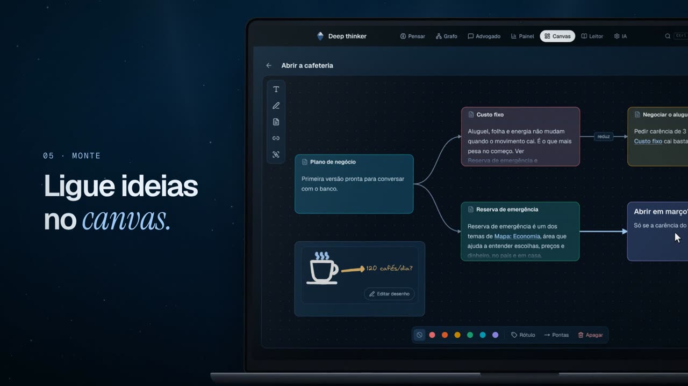
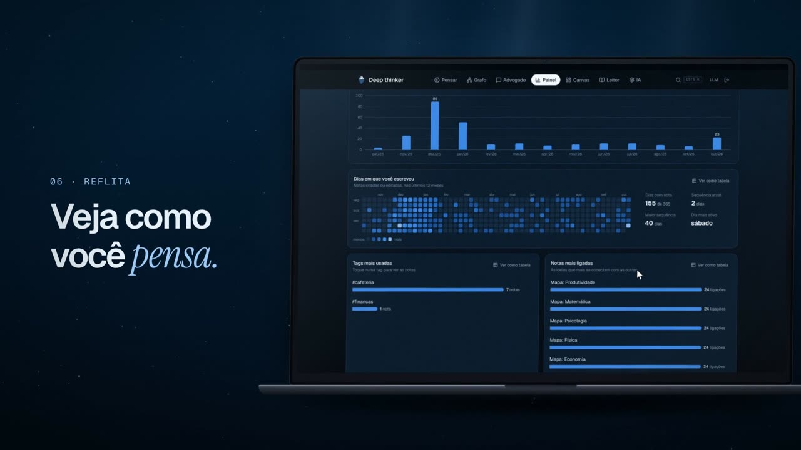
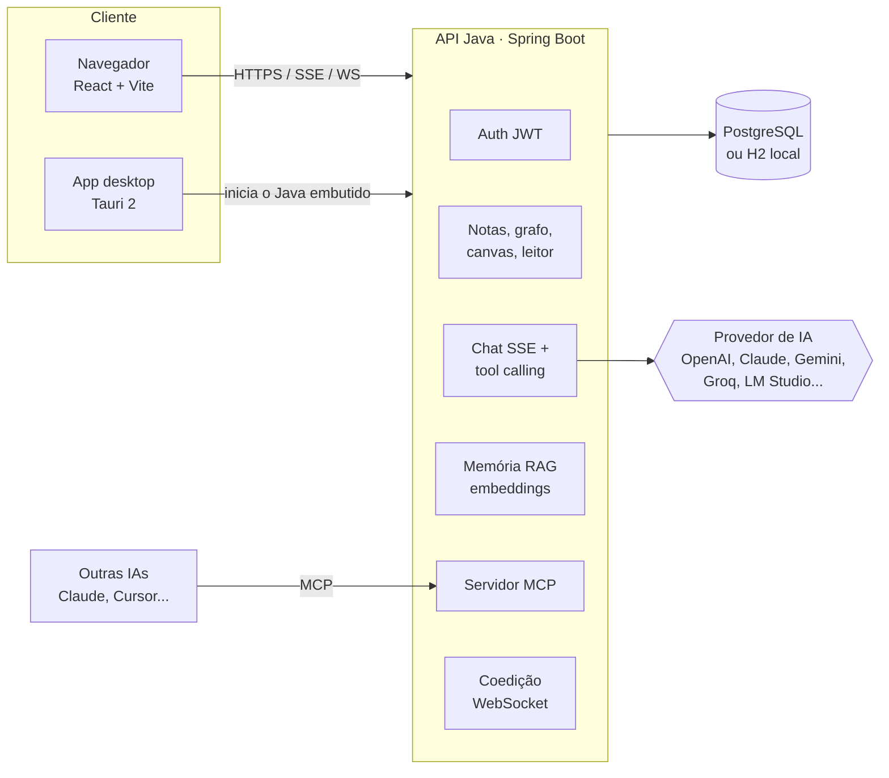

<div align="center">


# Deep thinker

**Um segundo cérebro em grafo, com uma IA que conhece o que você já pensou e discorda de você.**

Escreva notas, ligue ideias com `[[colchetes]]`, organize em grafo, quadro ou canvas, grife PDFs
e converse com um Advogado do Diabo que usa as suas próprias notas como memória.

<a href="https://deepthinker-app.vercel.app"></a>
<a href="https://github.com/Rick-Henrique7/DeepThinker/releases/latest"></a>

### 🌐 [deepthinker-app.vercel.app](https://deepthinker-app.vercel.app)

[](https://github.com/Rick-Henrique7/DeepThinker/actions/workflows/ci.yml)
[](https://github.com/Rick-Henrique7/DeepThinker/releases/latest)
[](https://github.com/Rick-Henrique7/DeepThinker/releases)
[](LICENSE)
<br />
[](backend-java)
[](backend-java)
[](frontend)
[](frontend)
[](frontend)
[](desktop)
[](backend-java)
[](#servidor-mcp)

[**Site**](https://deepthinker-app.vercel.app) ·
[**Baixar para Windows**](https://github.com/Rick-Henrique7/DeepThinker/releases/latest) ·
[Ver o vídeo](site/public/video/deepthinker-1080.mp4) ·
[Como rodar](#como-rodar) ·
[Arquitetura](#arquitetura) ·
[Portfólio do criador](https://henrique-santos-portfolio.vercel.app/)

<a href="https://deepthinker-app.vercel.app">
  
</a>

</div>

## O que ele faz

| | |
|---|---|
|  | **Escreva, tudo se conecta.** Cada `[[Título]]` vira uma ligação. O grafo mostra como as ideias se encontram, com backlinks, menções não ligadas e grafo local de cada nota. |
|  | **Uma IA que discorda de você.** O Advogado do Diabo tem três modos (Socrático, Crítico, Brainstorm), responde em streaming e lembra das suas notas por busca semântica (RAG). Ela também cria notas sozinha (tool calling). |
|  | **Do grafo ao quadro.** Mande notas para um Kanban, arraste cartões no mouse ou no toque, e veja tudo também em tabela, com tags e propriedades em YAML. |
|  | **Cada grifo vira nota.** Importe PDF, TXT ou Markdown. No Leitor, cada trecho grifado vira uma nota ligada ao documento, com comentário. |
|  | **Ligue ideias no canvas.** Um quadro infinito no formato aberto JSON Canvas, com cartões, setas e desenho à mão livre (Excalidraw). |
|  | **Veja como você pensa.** Painel com notas por semana, dias em que você escreveu e temas mais ligados. Todo gráfico tem a opção "ver como tabela". |

E mais: coedição em tempo real, histórico de versões com diff, nota do dia, paleta de comandos (`Ctrl+K`), modelos de nota,
diagramas Mermaid gerados pela IA, mapa mental de documentos, resumo em áudio, notas dentro de notas (`![[Nota]]`),
sistema de plugins, três temas (Abismo, Glaciar, Grafite) e layout pensado do celular ao monitor ultrawide.

## Baixar

| Plataforma | Como |
|---|---|
| **Windows 10/11** | Baixe o arquivo terminado em `-setup.exe` na [última versão](https://github.com/Rick-Henrique7/DeepThinker/releases/latest) e abra. Não precisa instalar Java: ele já vem dentro do app. |
| **Site** | Conheça o projeto, veja o vídeo e baixe em [deepthinker-app.vercel.app](https://deepthinker-app.vercel.app). |
| **Navegador** | Rode o app localmente (veja [Como rodar](#como-rodar)). |

> O instalador ainda não tem assinatura digital, então o Windows pode mostrar "O Windows protegeu o computador".
> Clique em **Mais informações** e depois em **Executar assim mesmo**.

No app desktop tudo fica no seu computador (banco em `%APPDATA%\com.deepthinker.desktop`). Para conversar com a IA,
escolha um provedor na aba **IA** e cole a sua chave, ou use um modelo local pelo LM Studio.

## Arquitetura



| Pasta | O que é | Tecnologia |
|---|---|---|
| [`frontend/`](frontend) | A aplicação web | React 18, TypeScript, Vite, Tailwind, D3, Yjs, Mermaid, pdf.js, Excalidraw |
| [`backend-java/`](backend-java) | A API | Java 21, Spring Boot 4, Spring Security, JPA, Flyway, LangChain4j, PDFBox |
| [`desktop/`](desktop) | O app para Windows | Tauri 2 (Rust) + o mesmo backend Java com um JRE enxuto gerado pelo `jlink` |
| [`site/`](site) | A página de apresentação | Vite, three.js, GSAP, anime.js |
| [`backend/`](backend) | Primeira versão da API, em Laravel | Mantida só como histórico da migração |

### Decisões técnicas, e por quê

- **Laravel para Java, sem quebrar o frontend.** A API foi reescrita em Spring Boot mantendo os mesmos endereços e o mesmo JSON (`snake_case`). O React não precisou mudar para trocar de backend.
- **JWT sem estado + BCrypt.** Cada requisição carrega quem é o usuário, então a API escala horizontalmente sem sessão no servidor. Cada pessoa só enxerga os próprios dados.
- **Chave de IA criptografada (AES-GCM).** Cada usuário traz a própria chave; ela é guardada cifrada no banco e nunca volta inteira para o navegador.
- **Plugins de IA.** Uma interface `LlmClient` com duas implementações (compatível com OpenAI e Anthropic) cobre 9 provedores. Adicionar outro é cadastrar um item no catálogo.
- **Memória com RAG + grafo.** As notas viram vetores (modelo `multilingual-e5-small` rodando dentro do Java via ONNX, ou embeddings do provedor). A busca pega as notas mais parecidas e soma os vizinhos no grafo (GraphRAG) antes de responder.
- **Streaming com SSE.** A resposta da IA aparece palavra por palavra, sem WebSocket só para isso.
- **Migrations com Flyway e H2 em modo PostgreSQL.** O mesmo SQL roda no H2 local (desenvolvimento e app desktop) e no Postgres em produção.
- **Desktop com Tauri em vez de Electron.** A janela usa o WebView do sistema; o Java vai junto com um runtime cortado pelo `jlink`. O app sobe o backend numa porta livre e o encerra quando a janela fecha.

### Servidor MCP

O backend também é um servidor [Model Context Protocol](https://modelcontextprotocol.io) (Streamable HTTP em `/mcp`).
Com um token gerado em **IA > Acesso por MCP**, outras IAs (Claude, Cursor e afins) podem ler e organizar as suas notas,
com 16 ferramentas: listar e abrir notas, criar notas, mover cartões no Kanban, criar e renomear colunas, criar canvas com cartões ligados e mais.
No modo ao vivo, você vê o cursor da IA navegando pelo app enquanto ela trabalha.

## Como rodar

Você precisa de **JDK 21** e **Node 20+**. O Maven vem junto pelo wrapper (`mvnw`).

```bash
# 1. API (porta 8000, banco H2 em backend-java/data)
cd backend-java
./mvnw spring-boot:run          # no Windows: .\mvnw.cmd spring-boot:run

# 2. Frontend (porta 5173), em outro terminal
cd frontend
npm install
npm run dev
```

Abra http://localhost:5173 e crie uma conta. A primeira conta é sua; para fechar o cadastro depois, use `REGISTRATION_ENABLED=false`.

<details>
<summary><b>Variáveis de ambiente principais</b></summary>

| Variável | Para quê | Padrão |
|---|---|---|
| `DEEPTHINKER_SECRET` | Assina os tokens e cifra as chaves de IA. **Troque em produção.** | um valor de desenvolvimento |
| `DATABASE_URL`, `DATABASE_USERNAME`, `DATABASE_PASSWORD` | Banco (use `jdbc:postgresql://...` em produção) | H2 em arquivo |
| `FRONTEND_ORIGIN` | Endereços liberados no CORS | `http://localhost:5173` |
| `REGISTRATION_ENABLED` | Permite novos cadastros | `true` |
| `LLM_PROVIDER` | Provedor de IA padrão | `openai` |
| `VITE_API_URL` (frontend) | Endereço da API | `http://localhost:8000/api` |

A lista completa está em [`backend-java/src/main/resources/application.yml`](backend-java/src/main/resources/application.yml).
</details>

<details>
<summary><b>Gerar o instalador do Windows</b></summary>

Precisa de Rust e do Visual Studio Build Tools (C++). Depois:

```bash
cd desktop
npm install
npm run build
```

O instalador sai em `desktop/src-tauri/target/release/bundle/nsis/`. Detalhes em [`desktop/README.md`](desktop/README.md).
Ao criar uma tag `v*`, o GitHub Actions gera o instalador e publica nos Releases sozinho.
</details>

## Testes

```bash
cd backend-java && ./mvnw verify     # 139 testes de API, autenticação, IA (com servidor falso), MCP e mais
cd frontend && npx playwright test   # testes de ponta a ponta no navegador, do celular ao desktop
```

O CI roda os testes do backend e o build do frontend a cada push.

## Autor

Feito por **Henrique Santos (Rick)**. [Site do projeto](https://deepthinker-app.vercel.app) · [Portfólio](https://henrique-santos-portfolio.vercel.app/) · [GitHub](https://github.com/Rick-Henrique7)

## Licença

[MIT](LICENSE). Use, modifique e distribua à vontade, mantendo o aviso de copyright.
